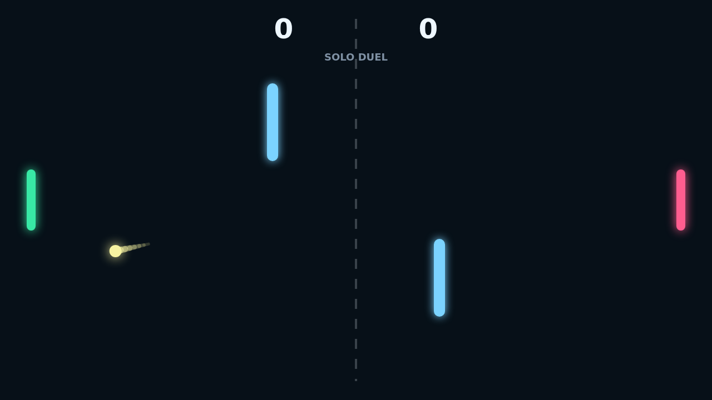
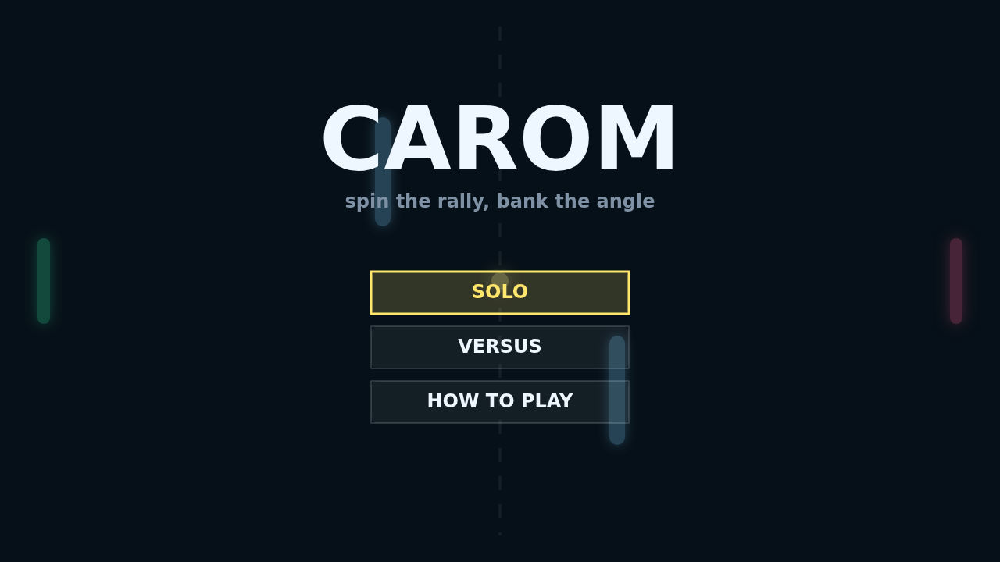

# Carom

Carom is a fast paddle duel played across a dark, neon-lit field. The opening
serve gives you a clean angle, but the rally quickly becomes a fight over the
middle: two bright bumpers split the court and turn every shot into a possible
bank.

The paddle is more than a wall. Move through the ball as it hits and you load it
with spin, bending the next flight path after the rebound. A flat return is
safe, but a spinning return can curl past the obstacle and force your opponent
to chase the wrong lane.

Solo mode lets you practice against the AI, while Versus mode turns the same
keyboard into a local duel. Points reset to a short hold before the next serve,
giving each player a breath before the next curve, ricochet, and match-point
scramble.

